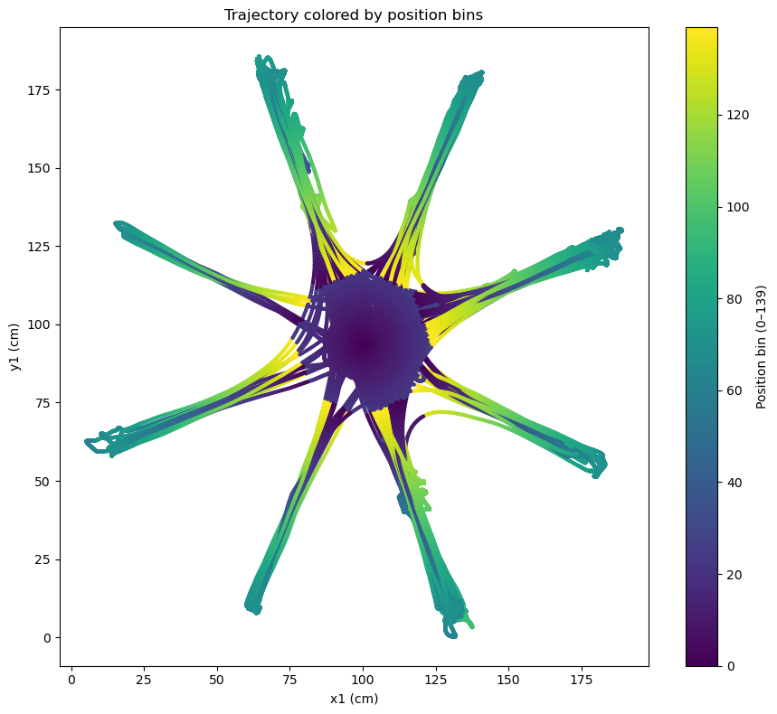
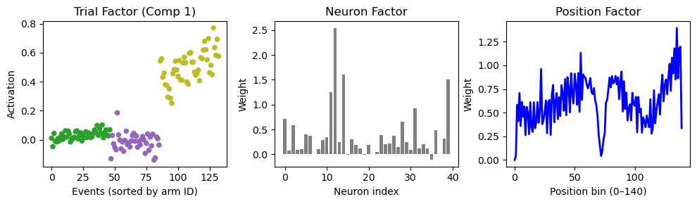

# Neural activity during an eight-arm maze task

How does the activity of a group of neurons relate to where an animal is, and which arm it visits next? This project explores that question through spike recordings and behavioral tracking from an eight-arm radial maze.

Seven Jupyter notebooks turn recordings into event-aligned arrays, test position modulation, decode arm identity and examine population structure with tensor decompositions.

**The recordings are not distributed.** You can browse the original figures in the notebooks, run the synthetic example below and inspect the analysis code and tests.



*Recorded movement through the maze, colored by the position coordinate used to align neural activity. From [tensor construction](construct_tensors.ipynb).*



*One component of a rank-3 decomposition: weights across visits, neurons and positions. Visits are sorted and colored by arm. From [CP/TCA](TCA_decomp.ipynb).*

These are figures from the original recording analysis, not reruns of the current code. See [figure provenance](docs/methods.md#saved-figures) and [interpretation limits](docs/methods.md#interpretation-limits).

## Run without recordings

Use **Python 3.12**. From the repository root:

```bash
python3.12 -m venv .venv
source .venv/bin/activate
python -m pip install -r requirements.txt
python -m scripts.synthetic_demo
python -m unittest discover -s tests -v
```

On Windows, activate the environment with `.venv\Scripts\activate` instead.

The example calls the functions defined in the analysis notebooks. It simulates spike timestamps and tracking, bins and smooths activity, constructs a `(neurons, retained time bins, events)` tensor, and runs a small Random Forest evaluation with a chronological holdout. It writes a figure and `summary.json` to `outputs/synthetic/`. It uses a smaller model grid and fewer permutations than the recording analyses.

Direct dependency versions are pinned; transitive dependencies are not fully locked.

## Analysis workflow

To analyze a local recording, start Jupyter from the repository root:

```bash
jupyter lab
```

Set the recording path and session identifiers in `import_preprocess.ipynb`, then run the first two notebooks. The remaining analyses branch from their outputs; only the rewarded-arm section of `pre_event_decoding.ipynb` also needs the RF export.

| Notebook | Purpose | Input → output |
| --- | --- | --- |
| [Import and preprocess](import_preprocess.ipynb) | Read spikes, cell labels, tracking and annotated visits | Recording files → `raw_data.pkl` |
| [Construct tensors](construct_tensors.ipynb) | Bin activity and align it to visits or position | `raw_data.pkl` → `tensors.pkl`, `qnn_data.pkl` |
| [Position modulation](position_modulation.ipynb) | Compare activity across linearized position slices | `tensors.pkl` → tuning plots and statistical summaries |
| [During-event decoding](RF_decoder.ipynb) | Predict arm identity from activity or trajectory features | `tensors.pkl` → metrics, diagnostic plots, `decoding_data.pkl` |
| [Around-event decoding](pre_event_decoding.ipynb) | Compare windows around entry and the preceding exit | `tensors.pkl`, `decoding_data.pkl` → time-resolved decoding plots |
| [CP/TCA](TCA_decomp.ipynb) | Separate event, neuron and position/time factors | `tensors.pkl` → factor plots |
| [SliceTCA](slicetca_decomp.ipynb) | Inspect structure across pairs of tensor dimensions | `tensors.pkl` → component plots and event projections |

The [technical guide](docs/methods.md) specifies filenames, timing conventions, tensor shapes, parameters and interpretation. `qnn_data.pkl` is an export for a separate analysis; no quantum model runs in this repository. Load only pickle files you trust.

## Reading the results

The notebooks remain exploratory analyses. Chronological holdouts and blocked validation are implemented, but preprocessing is not entirely confined to training data. Smoothed activity can cross event boundaries; some nominally pre-event windows include later activity. Decoding performance alone therefore does not demonstrate planning or isolate neural information from behavior.

Tensor ranks are fixed examples, not selected or validated estimates of population dimensionality. See the [methodological limits](docs/methods.md#interpretation-limits) for details.

Code is available under the [MIT license](LICENSE). The license does not grant access to the underlying recordings.
